<!-- Hero card: clicking it opens tutornote.ai -->

  <picture>
    <source media="(prefers-color-scheme: dark)" srcset="https://readme-typing-svg.demolab.com?center=true&vCenter=true&font=Inter&weight=500&size=20&duration=2600&pause=1400&color=C4B5FD&width=520&height=44&lines=Shipping+secure%2C+full-stack+products;AWS+Certified+Solutions+Architect+%E2%80%93+Associate;Sharpening+offensive+skills+on+HackTheBox" />
    
  </picture>

  

### About

Software developer at **Bank of America** · Information Technology & Systems (Cybersecurity) at **UT Dallas** · **AWS Certified Solutions Architect – Associate**

These days I'm focused on agentic security testing and hands-on offensive security.

### Building

- **[TutorNote.ai](https://tutornote.ai)** — AI-powered note & study app · [Windows client](https://github.com/Ifthikar20/Tutornote-windows-app)
- **[Turano.ai](https://turano.ai)**

### Stack

### Activity

  <!-- stats.svg is rebuilt daily by .github/workflows/profile.yml -->
  
  

  <picture>
    <source media="(prefers-color-scheme: dark)" srcset="https://raw.githubusercontent.com/Ifthikar20/Ifthikar20/output/github-snake-dark.svg" />
    <source media="(prefers-color-scheme: light)" srcset="https://raw.githubusercontent.com/Ifthikar20/Ifthikar20/output/github-snake.svg" />
    
  </picture>

